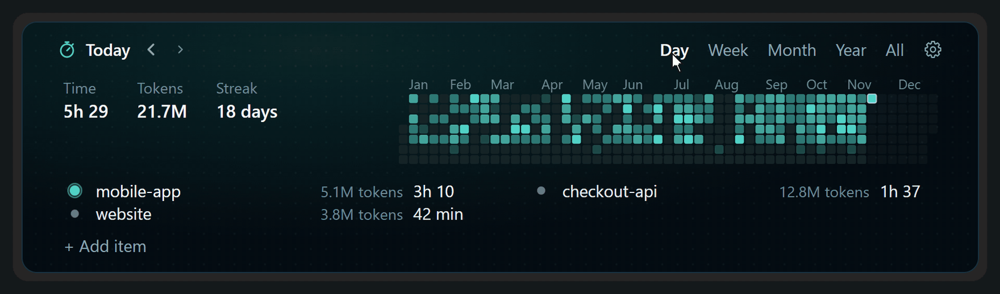
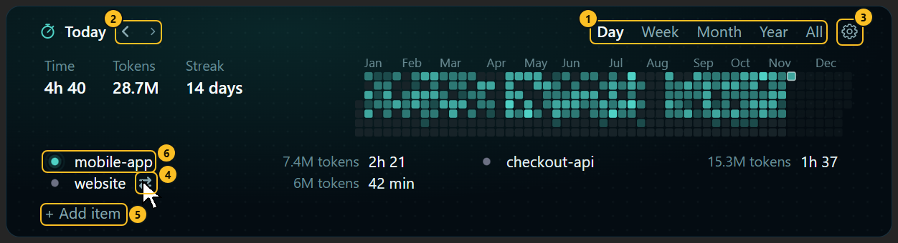
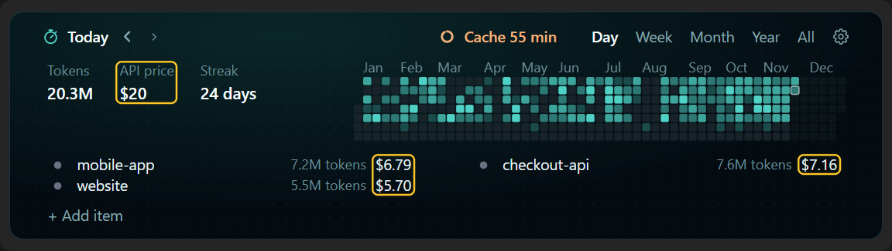
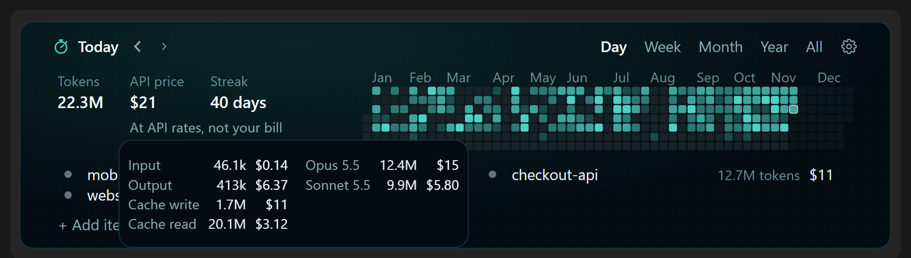
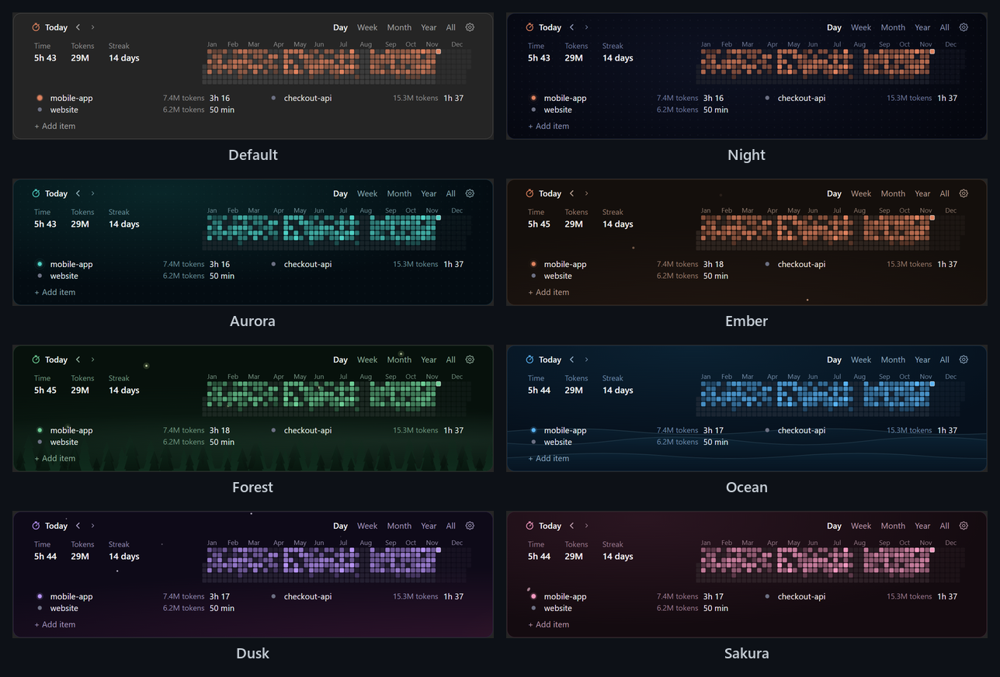

<h1 align="center">Worklog</h1>

<p align="center">
  <em>Automatically track the time, tokens and API price of each project in Claude Code, with a yearly activity heatmap and 8 themes to choose from.</em>
</p>

<p align="center">
  
  
  
</p>

<p align="center">
  
</p>

<p align="center">
  <a href="#quick-start">Quick start</a> ·
  <a href="#usage">Usage</a> ·
  <a href="#how-the-timer-works">How the timer works</a> ·
  <a href="#breaks">Breaks</a> ·
  <a href="#project-names">Project names</a> ·
  <a href="#tokens-and-price">Tokens and price</a> ·
  <a href="#themes">Themes</a> ·
  <a href="#in-the-terminal">Terminal</a> ·
  <a href="#settings">Settings</a> ·
  <a href="#faq">FAQ</a> ·
  <a href="#privacy-and-access">Privacy</a>
</p>

---

You use Claude on several projects. Worklog shows how much time each project takes, how many tokens it uses, and what these tokens would cost on the API. It tracks all of this automatically, above the prompt.

## What it does

- **Counts your time** while Claude works: answers, subagents, background commands, Ultracode and more.
- **Counts your tokens** and shows what they would cost on the API.
- **Shows your whole year** as a heatmap, with 8 themes to choose from.
- **Keeps your data** on your computer.

## Quick start

1. Install Worklog:

   ```sh
   claude plugin marketplace add Abdoul-sudo/worklog
   claude plugin install worklog@worklog
   ```

2. Restart Claude Code.
3. Work as usual.

A small button at the bottom shows your project and its time today, for example `⏱ mobile-app · 1h 12`. To open Worklog, click this button or type `/worklog`.

To get new versions, [turn on automatic updates](#update).

Worklog needs Claude Code 2.1.325 or later. Node.js is optional. If you have Node.js, Worklog also reads your past work.

## Update

Claude Code does not update Worklog by itself. Turn on automatic updates one time:

1. In Claude Code, type `/plugin`.
2. Open the **Marketplaces** tab.
3. Select **worklog**.
4. Select **Enable auto-update**.

After that, you get each new version when you start a session.

To update by hand instead, run these commands:

```sh
claude plugin marketplace update worklog
claude plugin update worklog@worklog
```

Then restart Claude Code, or type `/reload-plugins`.

To get a message for each new version, click **Watch** on this GitHub page. Then click **Custom**. Then select **Releases**.

## Usage

Each line in the list is a name: a project or a task. The bright dot shows the name of this session.

<p align="center">
  
</p>

1. **Choose the period.** Click **Day**, **Week**, **Month**, **Year** or **All**.
2. **Go back or forward.** Click **‹** to see the period before. Click **›** to see the period after.
3. **Open the settings.** Click the gear.
4. **Move this session to another name.** Point to the name. Then click **⇄** next to it. The time of this session goes to this name from now on.
5. **Move this session to a new name.** Click **+ Add item**. Type the name. Then press Enter.
6. **Rename.** Point to the name with the bright dot. Then click **✎** next to it. Type the new name. Then press Enter. Past days also get the new name.

In the terminal, click a name to move this session to it. To open the settings, click **≡**.

| Command | What it does |
| --- | --- |
| `/worklog` | Shows or hides Worklog. |
| `/worklog <name>` | Moves this session to `<name>`, from now on. For example: `/worklog PROJ-142`. |

## How the timer works

The timer counts while Claude works.

- **It starts** with your first message. Opening a session does not count.
- **It runs** while Claude works, even for hours without you.
- **It stops** when Claude is done. A break starts. When you come back, Worklog decides if the break counts. See [Breaks](#breaks).
- **Background commands** count while Claude waits for them. If you come back before the command ends, the wait is a break. For example, a dev server never ends.
- **Many things at once in one project** count once. 3 subagents that work for 10 minutes give 10 minutes, not 30.
- **Two projects at once** each get their time. The total shows the overlap, for example "incl. 1h 00 in parallel".

## Breaks

A break is the time between the end of Claude's work and your next message.

| Break | What Worklog does |
| --- | --- |
| Short: up to 1h | Counts the break as work. |
| Long: from 1h to 4h | Asks you if the break was work. |
| Very long: more than 4h | Does not count the break as work, and does not ask. |

<p align="center">
  
</p>

**Example.** Claude finishes at 10:00. You stop for a coffee. At 10:30, you send a new message. Worklog adds the 30 minutes at that moment. During the break, the total does not change. It catches up when you come back.

If you close Claude Code during a short break, the break counts as work up to the moment you close Claude Code.

When Worklog asks, click **Count** to add the break, or **Ignore** to leave it out.

<p align="center">
  
</p>

You can change the 1h and the 4h in the settings. To never get the question, set **Then ask** to **Never**.

## Project names

Worklog puts the time of each session under one name, for example a project or a task. It picks the name in this order:

1. The name that you choose, with `/worklog <name>` or in the list.
2. An ID in your messages, for example `PROJ-142`.
3. An ID in the name of your Git branch, for example `feature/PROJ-142-login`.
4. The name of the project folder. In a Git worktree, the name of the main project.

When Worklog finds the first ID of a session, the time before it also goes to this ID.

To choose the name yourself, see [Usage](#usage).

## Tokens and price

Do you prefer tokens to time? In the settings, set **Show** to **Tokens and price**. Worklog then shows the API price in place of the time.

<p align="center">
  
</p>

- The price is what your tokens would cost on the Anthropic API.
- On a Pro or Max plan, it is not what you pay. It shows what the same work would cost on the API.
- Worklog always counts the price, even when it shows the time. So your past days have a price too.

### Token details

Point to **Tokens** or **API price**. A box shows where your tokens went:

- On the left, each type of token: input, output, cache write and cache read.
- On the right, each model, for example Opus or Sonnet.

This box is in the desktop app and VS Code.

<p align="center">
  
</p>

## Themes

Worklog has 8 themes in the desktop app. To change the theme, click the gear. Then click a theme.

<p align="center">
  
</p>

## In the terminal

Worklog works in the terminal too, with the same data. In a wide terminal, the heatmap shows one square for each day.

<p align="center">
  
</p>

To click in Worklog in the terminal, use the fullscreen mode: `/tui fullscreen`.

## Settings

<p align="center">
  
</p>

| Setting | Default | What it does |
| --- | --- | --- |
| Show the activity heatmap | On | Shows one square for each day of the year. |
| Show | Time and tokens | Shows the time and the tokens, or the tokens and their API price. |
| Language | English | English or French. |
| Stay active during breaks | Up to 1h | A break up to this length is short: it counts as work. |
| Then ask | Up to 4h | For a long break, up to this length, Worklog asks you if it was work. A very long break does not count. **Never** turns off the question. |
| Theme | Night | Default, Night, Aurora, Ember, Forest, Ocean, Dusk or Sakura. Desktop app only. |

## FAQ

<details>
<summary><strong>Where does the API price come from?</strong></summary>

Worklog takes the prices from the public [LiteLLM price list](https://github.com/BerriAI/litellm). It gets the list again once a day.

For your past work, Worklog reads the details of each answer in your Claude Code history. If Claude Code deleted an old conversation, the tokens of that conversation have no price.

</details>

<details>
<summary><strong>Do all tokens have the same price?</strong></summary>

No. The API gives a different price to each type of token, and Worklog uses each price:

- Input tokens (what Claude reads): the normal price.
- Output tokens (what Claude writes): about 5 times the input price.
- Cache writes (Claude saves your conversation for later): 1.25 times the input price for 5 minutes, 2 times for 1 hour.
- Cache reads (Claude reads the saved conversation again): only 0.1 times the input price.

In long sessions, most tokens are cache reads. They are cheap, so many tokens can still cost little.

</details>

<details>
<summary><strong>Does a resumed or forked conversation count twice?</strong></summary>

No. When you resume or fork a conversation, Claude Code can copy old messages into the new file. Worklog counts each message only once.

</details>

<details>
<summary><strong>What does Worklog not count?</strong></summary>

Work outside Claude Code: meetings, calls and other tools.

</details>

## Privacy and access

Worklog runs on your computer and keeps its data there. This is all that it can do:

| Access | What Worklog does |
| --- | --- |
| Reads files | Its own data in `~/.claude/worklog/`. Your Claude Code history in `~/.claude/projects/`, for the time, the tokens and the model of each answer. |
| Writes files | Only its own data, in `~/.claude/worklog/`. |
| Runs commands | `git branch --show-current`, to find an ID in the branch name. `node`, to read your past history. |
| Network | Once a day, it downloads the public LiteLLM price list. It sends nothing about you or your work. |
| Your messages | It reads each message to find an ID, for example `PROJ-142`. It does not keep your messages. |

To stop the price download, set the environment variable `WORKLOG_PRICES` to `off`. To keep the data in another folder, set the environment variable `WORKLOG_DATA_DIR`.

## Uninstall

```sh
claude plugin uninstall worklog@worklog
```

Your data stays in `~/.claude/worklog/`. To remove it, delete this folder.

## License

[MIT](LICENSE)
