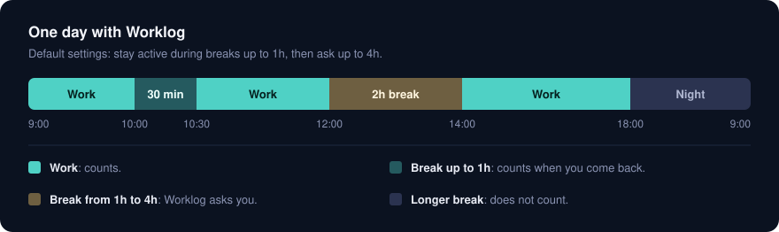
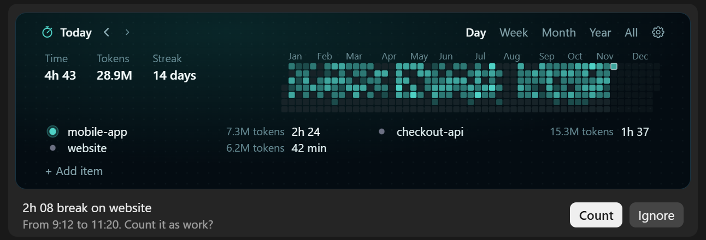
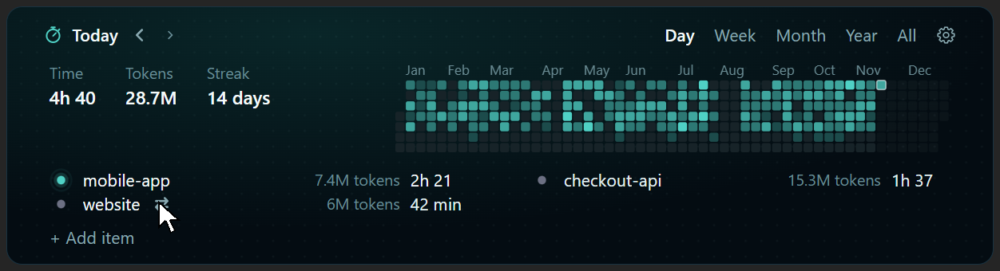

<h1 align="center">Worklog</h1>

<p align="center">
  <em>Time and tokens for each project, counted for you while you work with Claude.</em>
</p>

<p align="center">
  
  
  
  
</p>

<p align="center">
  
</p>

<p align="center">
  <a href="#quick-start">Quick start</a> ·
  <a href="#how-the-timer-works">How the timer works</a> ·
  <a href="#breaks">Breaks</a> ·
  <a href="#project-names">Project names</a> ·
  <a href="#themes">Themes</a> ·
  <a href="#in-the-terminal">Terminal</a> ·
  <a href="#settings">Settings</a> ·
  <a href="#faq">FAQ</a>
</p>

---

At the end of the week, someone asks: how long did the checkout API take? How many tokens did it use? You do not remember, and you never started a timer.

Worklog remembers. It counts the time and the tokens of each Claude Code session, and shows them above the prompt. You do not start, stop or pause anything.

## Quick start

```sh
claude plugin marketplace add Abdoul-sudo/worklog
claude plugin install worklog@worklog
```

Restart Claude Code, then work as usual. A chip at the bottom shows the name of the session and its time today, for example `⏱ mobile-app · 1h 12`. Click the chip to open Worklog, or type `/worklog`.

Worklog needs Claude Code 2.1.325 or later. Node.js is optional: Worklog uses it once, to read your past history.

## How the timer works

- The timer starts with your first message in a session. Opening a session does not count.
- The timer runs while Claude works: answers, subagents, workflows and Ultracode, even when they work alone for hours.
- When Claude is done, a break starts. Worklog decides about the break when you come back.
- When two sessions work at the same time, both count. Worklog shows how much of the day was in parallel.

## Breaks

A break is the time between the end of Claude's work and your next message.

<p align="center">
  
</p>

**Example.** Claude finishes at 10:00. You stop for a coffee. At 10:30, you send a new message. Worklog adds the 30 minutes at that moment. During the break, the total does not change. It catches up when you come back.

| Break | What Worklog does |
| --- | --- |
| Up to 1h | Counts the break as work. |
| From 1h to 4h | Asks you if the break was work. |
| Longer than 4h | Does not count the break, and does not ask. |

If you close Claude Code during a break, the break counts until you close it, if it is shorter than 1h.

When Worklog asks, click **Count** to add the break, or **Ignore** to leave it out.

<p align="center">
  
</p>

You can change the 1h and the 4h in the settings. To never get the question, set **Then ask** to **Never**.

## Project names

Each session counts for one name, such as a project or a task. Worklog decides on the name in this order:

1. The name that you choose, with `/worklog <name>` or in the list.
2. An ID in your messages, such as `PROJ-142`.
3. An ID in the name of your Git branch, such as `feature/PROJ-142-login`.
4. The name of the project folder. In a Git worktree, the name of the main project.

When Worklog finds the first ID of a session, the time before it also goes to this ID.

To count a session for another name, point to the name in the list, then click **⇄**.

<p align="center">
  
</p>

## Themes

Worklog has eight themes in the desktop app. Click the gear, then click a theme.

<p align="center">
  
</p>

## In the terminal

Worklog works in the terminal too, with the same data. In a wide terminal, the heatmap shows one square for each day.

<p align="center">
  
</p>

To click in Worklog in the terminal, use the fullscreen mode: `/tui fullscreen`.

## Usage

| Task | Action |
| --- | --- |
| See another period | Click **Day**, **Week**, **Month**, **Year** or **All**. Click **‹** or **›** to go back or forward. |
| Count this session for another name | Point to the name, then click **⇄**. In the terminal, click the name. |
| Count this session for a new name | Click **+ Add item**, type the name, then press Enter. |
| Rename | Click **✎** next to the name. The new name also replaces the old one on past days. |
| Open the settings | Click the gear. In the terminal, click **≡**. |

| Command | What it does |
| --- | --- |
| `/worklog` | Shows or hides Worklog. |
| `/worklog <name>` | Counts this session for `<name>`. For example: `/worklog PROJ-142`. |

## Settings

<p align="center">
  
</p>

| Setting | Default | What it does |
| --- | --- | --- |
| Show the activity heatmap | On | Shows one square for each day of the year. |
| Show | Time and tokens | Shows the time, the tokens, or both. |
| Language | English | English or French. |
| Stay active during breaks | Up to 1h | A shorter break counts as work. |
| Then ask | Up to 4h | Worklog asks about a longer break, up to this length. **Never** turns off the question. |
| Theme | Night | Default, Night, Aurora, Ember, Forest, Ocean, Dusk or Sakura. Desktop app only. |

## Update

```sh
claude plugin marketplace update worklog
claude plugin update worklog@worklog
```

Then restart Claude Code, or type `/reload-plugins`.

## Uninstall

```sh
claude plugin uninstall worklog@worklog
```

Your data stays in `~/.claude/worklog/`. To remove it, delete this folder.

## FAQ

<details>
<summary><strong>Does the timer stop when I leave?</strong></summary>

Yes. The timer runs only while Claude works. When you come back, Worklog decides if your break counts.

</details>

<details>
<summary><strong>I take a 30-minute break, then I send a message. Does the total grow by 30 minutes?</strong></summary>

Yes, with the default settings. Worklog adds the 30 minutes when you send the message. During the break, the total does not move.

</details>

<details>
<summary><strong>Do subagents and Ultracode count?</strong></summary>

Yes. The timer runs while they work, even when you do not type. Their tokens count too.

</details>

<details>
<summary><strong>Does Worklog see my past work?</strong></summary>

Yes, if Node.js is installed. On the first start, Worklog reads your Claude Code history. Without Node.js, Worklog counts from the day you install it.

</details>

<details>
<summary><strong>What does Worklog not count?</strong></summary>

Work outside Claude Code: meetings, calls and other tools.

</details>

## Privacy

Worklog keeps its data on your computer, in `~/.claude/worklog/`. It does not keep your messages. It sends nothing over the network.

To keep the data in another folder, set the environment variable `WORKLOG_DATA_DIR`.

## License

[MIT](LICENSE)
