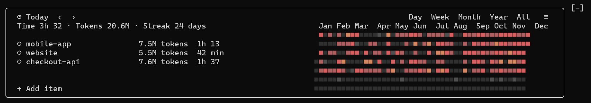

# Worklog

**Know where your time and tokens go, item by item, without a timer.**

Worklog is a mod for [Claude Code](https://code.claude.com). It counts the time and the tokens you spend on each item (a ticket, a branch, a project) from your activity in Claude Code. You work as usual. At the end of the day, open Worklog and copy the durations into your tracker.


## Features

- **No timer.** Each message counts. You start and stop nothing.
- **Finds the item for you.** First in your messages (`FSY-I478`), then in the Git branch (`feature/FSY-I478-export`). Without an ID, the session uses its group in the desktop app, or the project name.
- **Time and tokens per item.** For the day, the week, the month, the year, or since you started. Arrows go back to past periods.
- **Yearly activity heatmap.** One square per day, from January to December, as on GitHub.
- **Parallel sessions.** Each session counts. Two sessions on the same item are grouped.
- **Autonomous work counts.** Subagents, workflows and Ultracode count while they run, even for hours.
- **Your past history too.** Worklog reads the history of Claude Code, so your first popover already shows your past days.
- **Everywhere.** The terminal, the desktop app and VS Code. English and French.
- **Four themes.** Simple, Night, Aurora and Ember, in the desktop app.



## Install

```sh
claude plugin marketplace add Abdoul-sudo/claude-worklog
claude plugin install worklog@worklog
```

Then run `/reload-plugins`, or start a new session.

You can also install Worklog with other useful mods in one step, with [claude-modpack](https://github.com/Abdoul-sudo/claude-modpack).

<details>
<summary>Install without the terminal</summary>

- **Desktop app:** click **+** next to the prompt, then **Plugins**. Add the marketplace `Abdoul-sudo/claude-worklog`, then install `worklog`.
- **VS Code:** type `/plugins`, then open the **Marketplaces** tab. Add `Abdoul-sudo/claude-worklog`, then install `worklog`.

</details>

## Use

**Day to day, you do nothing.** A chip at the bottom shows the item of the session and its time for today: `⏱ FSY-I478 · 1h 12`. Click the chip to open Worklog. Click it again to close it.

| To… | Do this |
| --- | --- |
| Move this session to another item | Point to the item in the list, then click ⇄. In the terminal, click its name. |
| Use an item that is not in the list | Click **+ Add item**, type the ID or a name, then press Enter. |
| Rename the item of the session | Click ✎ next to its name. The new name applies everywhere, past days included. |
| See another period | Click **Day**, **Week**, **Month**, **Year** or **All**. The arrows ‹ › go back and forward. |
| Change the settings | Click the gear. |

An item that you choose by hand stays: a message or the Git branch does not change it.

After a long idle time, a line asks if this time was work. **Yes** counts it. **No** leaves it out.

### Where Worklog shows

| Surface | Chip | Worklog |
| --- | --- | --- |
| Desktop app | At the bottom right, before the session mode | Above the prompt |
| Terminal | On the line under the prompt | Above the prompt |
| VS Code | In the status line | In a side pane: type `/worklog` |

### Settings

Open Worklog, then click the gear.


| Setting | Default |
| --- | --- |
| Show the activity heatmap | On |
| Ask after a long idle time | On |
| Show | Time and tokens (or only one of them) |
| Language | English (or Français) |
| Theme (desktop app) | Night |
| Idle time counted as work | Up to 45 min |

### Commands

| Command | What it does |
| --- | --- |
| `/worklog` | Opens Worklog. |
| `/worklog day` | Today, as text. |
| `/worklog week` | This week, day by day, as text. |
| `/worklog month` | This month, as text. |
| `/worklog FSY-I478` | Moves this session to this item. |
| `/worklog stop` | Pauses this session until your next message. |
| `/worklog gaps` | Lists the idle gaps to sort. `/worklog gaps 1 work` counts gap 1. |

```
Today

  FSY-I478   2h 14    3.1M tokens  (active)
  FLO-I165   1h 05    1.1M tokens
  Total      3h 19    4.2M tokens
```

## How the time is counted

<details>
<summary>The rules</summary>

- The time starts with the first message of the session. To open a session does not count.
- While Claude works, all the time counts: your turns, and also the subagents, workflows and Ultracode that run alone.
- An idle time shorter than 45 min counts. A longer idle time does not count, unless you answer **Yes**.
- The first ID found in a session also gets the time before it.
- The item stays with the session, also on the next day.
- The chip shows the time of the session. The list shows the time per item, for all the sessions.
- Two sessions on two items count both. The total of the day can be more than the real time. Worklog shows it ("incl. 40 min in parallel").
- The tokens are the tokens of the answers of Claude: sessions, subagents and cache reads included. Each answer counts one time.
- `/stats` shows other numbers: it does not count the subagents, and it ends the days at midnight UTC.
- If you close a window without quitting Claude Code, the count stops after 2 min at most.

</details>

Your data stays on your computer, in `~/.claude/temps/`. To keep it in another folder, set the environment variable `WORKLOG_DATA_DIR`.

## Limits

- Worklog counts your activity in Claude Code only. A meeting or a call does not count.
- Worklog finds IDs in the Zoho Sprints format, in capitals: `FSY-I478`. For other items, click **+ Add item** and type a name.
- To read your past history, Worklog needs Node.js. Without Node.js, it counts from the day you install it.
- In the terminal, clicks need the fullscreen mode (`/tui fullscreen`).
- Worklog needs Claude Code 2.1.290 or later, and the VS Code extension 2.1.299 or later.

## Development

```sh
claude plugin test .
claude plugin validate .
```

| File | Role |
| --- | --- |
| `hooks/calcul.ts` | Counts the time and the tokens. No side effects. |
| `hooks/activite.ts` | The activity heatmap, in SVG and in the terminal. |
| `hooks/dessins.ts` | The themes and the icons. |
| `hooks/texte.ts` | The texts of `/worklog day`, `week` and `month`. |
| `hooks/langue.ts` | The English and French texts. |
| `hooks/register.tsx` | The hooks, the command, the chip, the popover and the settings. |
| `scripts/importer.mjs` | Reads the history of Claude Code. |
| `tests/` | The tests. |

## License

[MIT](LICENSE)
