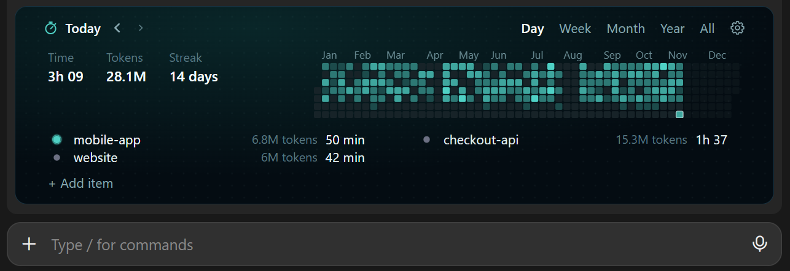
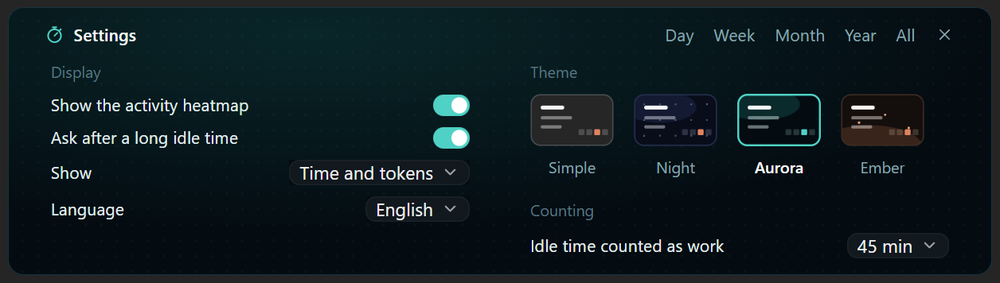

# Worklog

**Automatic time and token tracking for Claude Code, per project.**

[](LICENSE)
[](https://code.claude.com)

Worklog is a mod for [Claude Code](https://code.claude.com). It records your activity in Claude Code and turns it into a clear log: the time you spent on each project, the tokens each project used, and your activity over the year. There is no timer to start or stop.



## Contents

- [Features](#features)
- [Requirements](#requirements)
- [Installation](#installation)
- [Usage](#usage)
- [Configuration](#configuration)
- [How time is counted](#how-time-is-counted)
- [Data and privacy](#data-and-privacy)
- [Limitations](#limitations)
- [Development](#development)
- [License](#license)

## Features

- **Automatic tracking.** Your messages, the answers of Claude and the work of subagents count. You do not start or stop anything.
- **Per project.** Each session logs its time under the name of its project. In the desktop app, the name of the session group is used first.
- **Per ticket, when you need it.** Worklog also finds ticket IDs in your messages and in the name of the Git branch.
- **Time and tokens.** For the day, the week, the month, the year, or since you started. Arrows go back to past periods.
- **Activity heatmap.** The whole year at a glance, with one square per day.
- **Parallel sessions.** Each session counts on its own. Sessions on the same project are merged.
- **Past history.** Worklog reads the history of Claude Code. Your past days show from the first launch.
- **Desktop app and terminal.** Four themes in the desktop app. English and French.
- **Local.** Your data stays on your computer.

## Requirements

- Claude Code 2.1.290 or later, in the desktop app or in the terminal.
- Node.js, to import your past history. This is optional: without Node.js, Worklog starts to count from the day you install it.

## Installation

```sh
claude plugin marketplace add Abdoul-sudo/claude-worklog
claude plugin install worklog@worklog
```

Then run `/reload-plugins`, or start a new session.

In the desktop app, you can also click **+** next to the prompt, then **Plugins**. Add the marketplace `Abdoul-sudo/claude-worklog`, then install **worklog**.

Worklog is also part of [Claude Modpack](https://github.com/Abdoul-sudo/claude-modpack), a set of mods that you install in one step.

## Usage

### Quick start

1. Work in Claude Code as usual.
2. Look at the chip at the bottom: it shows the project of the session and its time for today, for example `⏱ mobile-app · 1h 12`.
3. Click the chip, or run `/worklog`, to open Worklog above the prompt. Click the chip again to close it.

In the desktop app, the chip is at the bottom right of the prompt. In the terminal, it is on the line under the prompt.

### The Worklog panel

| To | Do this |
| --- | --- |
| See another period | Click **Day**, **Week**, **Month**, **Year** or **All**. Use **‹** and **›** to go back and forward. |
| Log this session under another name | Point to the name in the list, then click **⇄**. In the terminal, click the name. |
| Log time under a new name | Click **+ Add item**, type the name, then press Enter. |
| Rename the current entry | Click **✎** next to its name. The new name also applies to past days. |
| Change the settings | Click the gear. |

A name that you choose by hand stays with the session. A message or a Git branch does not replace it.

After a long idle time, Worklog asks if this time was work. **Yes** counts it. **No** leaves it out.

### Commands

| Command | Description |
| --- | --- |
| `/worklog` | Opens Worklog. |
| `/worklog day` | Prints today, as text. |
| `/worklog week` | Prints this week, day by day. |
| `/worklog month` | Prints this month. |
| `/worklog FSY-I478` | Logs this session under this ticket ID. |
| `/worklog stop` | Pauses this session until your next message. |
| `/worklog gaps` | Lists the idle times that are not counted yet. `/worklog gaps 1 work` counts the first one. |

The text output is easy to copy into a time sheet:

```
Today

  mobile-app     2h 14    3.1M tokens  (active)
  checkout-api   1h 05    1.1M tokens
  Total          3h 19    4.2M tokens
```

## Configuration

Open Worklog, then click the gear.



| Setting | Default | Description |
| --- | --- | --- |
| Show the activity heatmap | On | Shows the yearly heatmap. |
| Ask after a long idle time | On | Asks if a long idle time was work. |
| Show | Time and tokens | Shows the time, the tokens, or both. |
| Language | English | English or French. |
| Theme | Night | Simple, Night, Aurora or Ember. Desktop app only. |
| Idle time counted as work | 45 min | A shorter idle time counts as work. |

To keep your data in another folder, set the environment variable `WORKLOG_DATA_DIR`. You can set it in the `env` section of your Claude Code settings.

## How time is counted

- The time of a session starts with its first message. A session that you only open does not count.
- While Claude works, all the time counts. This includes subagents, workflows and long autonomous runs.
- An idle time shorter than the limit (45 min by default) counts. A longer idle time counts only if you answer **Yes**.
- The chip shows the time of the session. The list shows the time of each name, for all sessions.
- Two sessions on two projects count both. The total of a day can be more than the real time. Worklog then shows the part in parallel.
- Tokens include the answers of Claude, the subagents and the cache reads. Each answer counts one time.
- If you close a window without quitting Claude Code, the count stops after 2 minutes at most.

Worklog and `/stats` can show different numbers. `/stats` does not count subagents, and it ends each day at midnight UTC.

## Data and privacy

Worklog writes a small journal of your activity in `~/.claude/temps/`, one file for each session and day. It contains times, session IDs, names and token counts. It does not contain your messages.

Worklog sends nothing over the network.

## Limitations

- Worklog counts your activity in Claude Code only. A meeting or a call does not count.
- Ticket detection supports the Zoho Sprints format, in capital letters: `FSY-I478`. For other trackers, use **+ Add item** or the name of the project.
- In the terminal, clicks need the fullscreen mode (`/tui fullscreen`).

## Development

```sh
claude plugin test .
claude plugin validate .
```

| Path | Role |
| --- | --- |
| `hooks/calcul.ts` | Counts the time and the tokens. No side effects. |
| `hooks/activite.ts` | Draws the activity heatmap, in SVG and in the terminal. |
| `hooks/dessins.ts` | Themes and icons. |
| `hooks/texte.ts` | Text output of `/worklog day`, `week` and `month`. |
| `hooks/langue.ts` | English and French strings. |
| `hooks/register.tsx` | Hooks, command, chip, panel and settings. |
| `scripts/importer.mjs` | Imports the history of Claude Code. |
| `tests/` | Tests. |

Issues and pull requests are welcome.

## License

[MIT](LICENSE) © Abdoul-sudo
